<p align="center">
  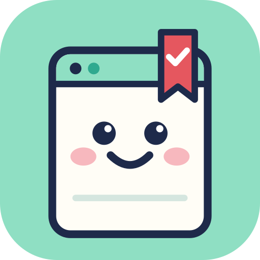
</p>

<h1 align="center">Someday</h1>

<p align="center">
  <b>Send a Reel. Get a to-do list.</b><br>
  <i>Because someday should actually happen.</i>
</p>

<p align="center">
  <a href="https://someday-lemon.vercel.app">Live app</a> ·
  <a href="https://www.youtube.com/watch?v=seIgZlR1j8s">Demo video (3 min)</a> ·
  Built for the Meta Global AI Developer Hackathon
</p>

<p align="center">
  <a href="https://www.youtube.com/watch?v=seIgZlR1j8s">
    
  </a>
</p>

---

## Why this exists

You know the feeling. You're scrolling, you find a Reel that's genuinely useful: a 15-minute pasta, a LeetCode trick for your interview, a café in Bengaluru everyone swears by, a two-day Jaipur plan. So you save it. Maybe you DM it to yourself "for later".

Later never comes. It sinks under a thousand other saves and you never open it again. One Redditor put it best: *99% of my saved recipes? Never cooked.*

The world learns on Instagram now. The ideas are there. The follow-through isn't. **Someday is the follow-through.**

## How it feels to use

1. **Share any Reel to Tick**, our Instagram bot, exactly like you'd send it to a friend.
2. **Tick replies in your DMs** with a card and one button for the thing to do next.
3. **Everything lands in your Someday web app**, already sorted into lists, so nothing gets lost.

No new app to open. No folders to manage. Just send a message.

## What Tick does with different Reels

Someday isn't a movie app or a recipe app. It works on whatever you send it.

| You send a Reel about… | Tick gives you back |
|---|---|
| A film or show | The poster, where it's streaming in your country (Netflix, Prime…), trailer, cast and reviews |
| A coding problem | The exact LeetCode problem (confirmed with LeetCode), its difficulty, how long it takes, and video lessons that YouTube confirms exist |
| A video game | Where to play it (PS5, Xbox, Switch, PC…), the Steam page and price, and the official trailer |
| Cafés or places | Every place pinned on a map, with photos, a short intro, and directions |
| A trip | Each sight as its own stop, on the map, ready for a weekend plan |
| A recipe | Ingredients, steps, the kit you'll need, a shopping list you can copy, and a step-by-step cook mode |
| A deadline, event or hackathon | The date checked against the official source, plus an "Add to calendar" button |
| A claim that sounds too good to be true | A **fact check**: Likely false, Misleading or Checks out, with links to the sources |

Every reply also brings back one older save you forgot about. You can tap **Done** right inside Instagram, or just ask Tick *"what should I watch tonight?"* and it answers from your own saves.

## Screenshots

| Instagram DM | Any kind of Reel | Fact check |
|---|---|---|
| 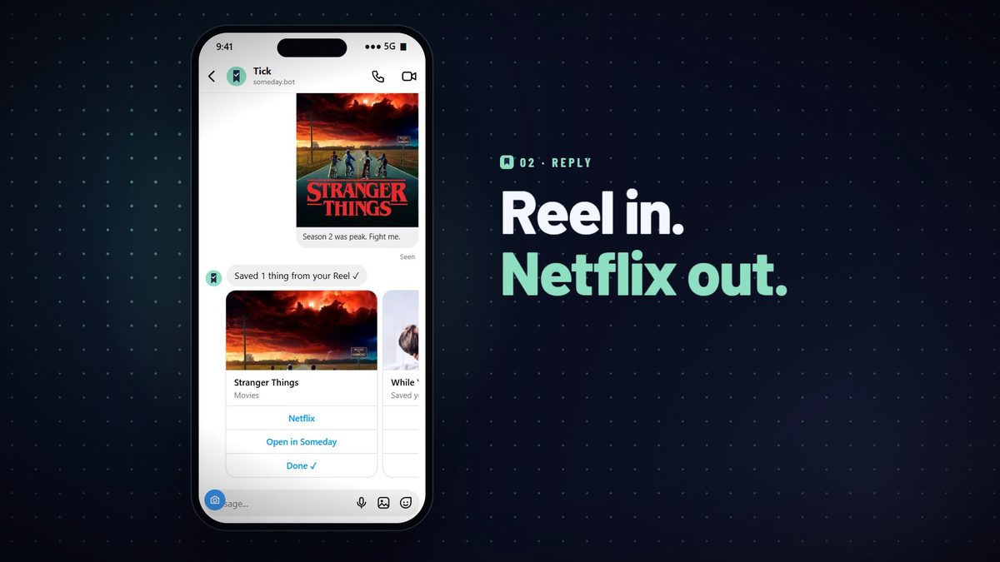 | 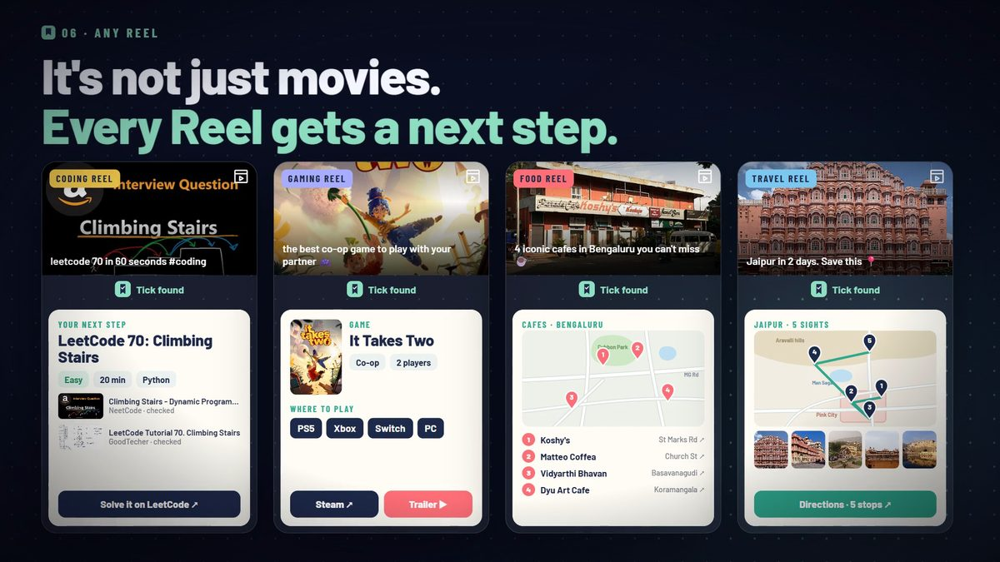 | 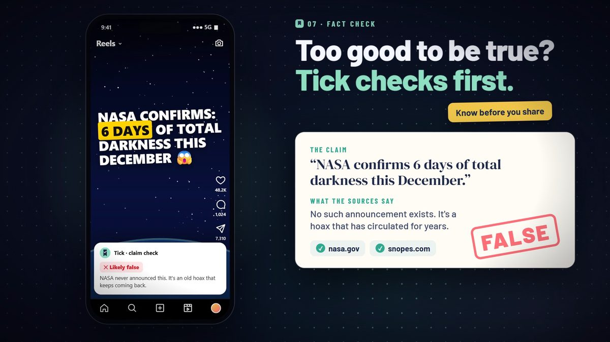 |

| Today in the web app | A film, ready to stream | Places on a map |
|---|---|---|
| 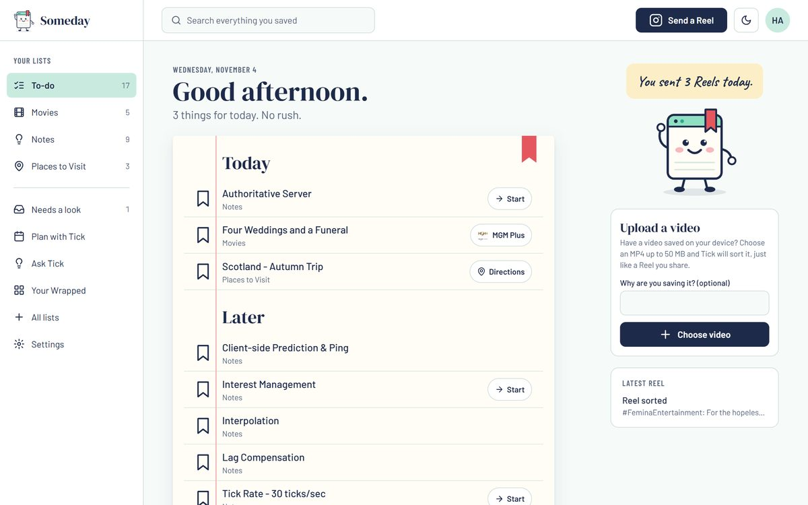 | 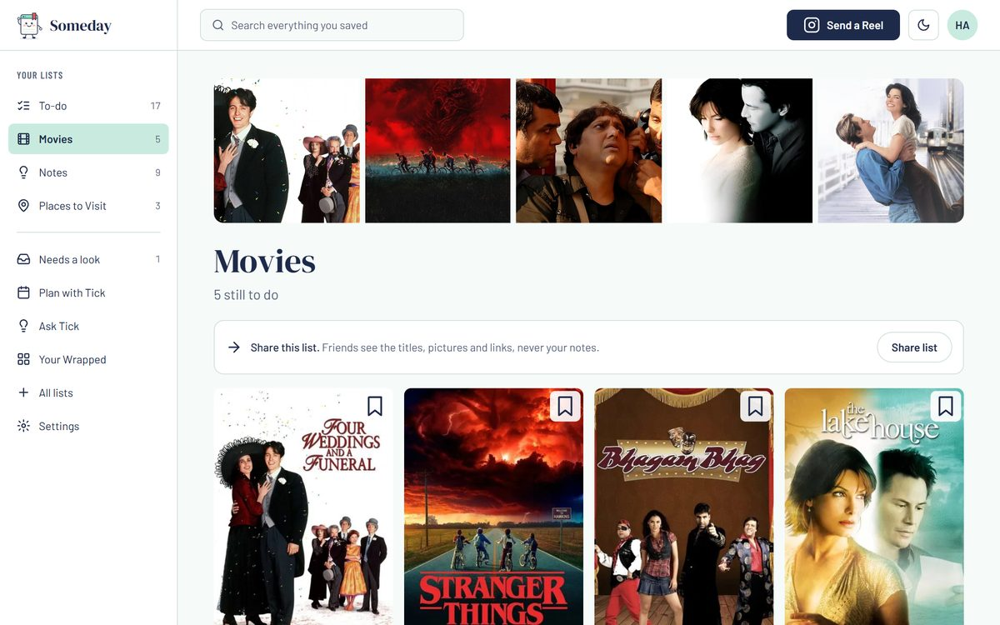 | 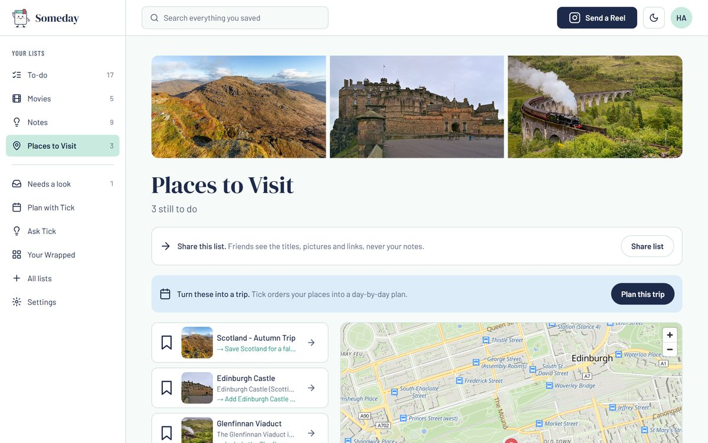 |

| "Do it now" on any item | Fact check page | Where to play |
|---|---|---|
| 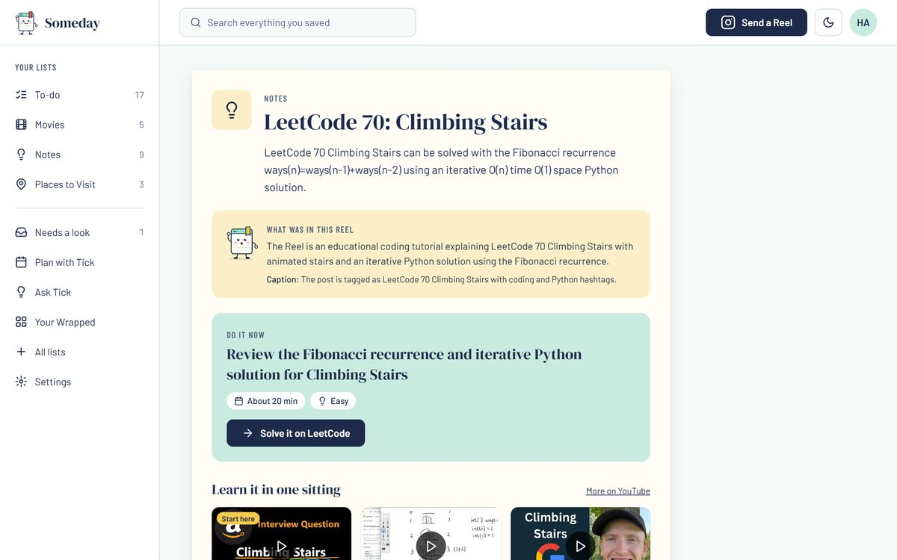 | 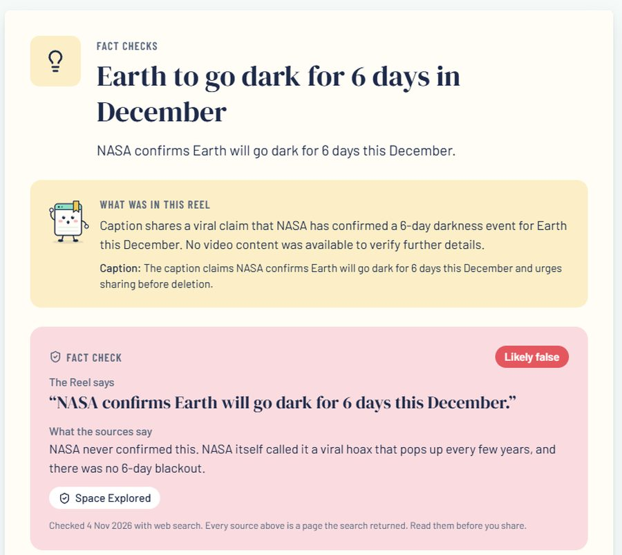 | 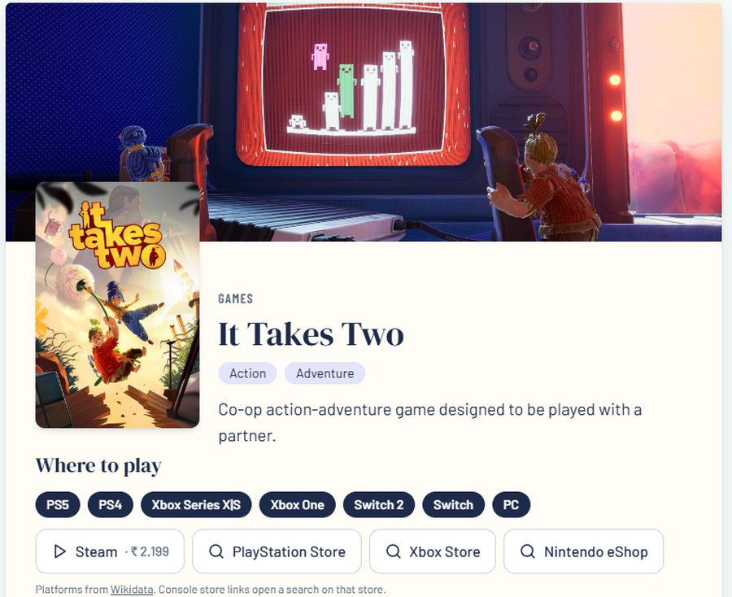 |

## The web app

- **Today:** three easy wins picked from everything you saved, so you start small.
- **Ready when you are:** every save with its one-tap button. Filter by Watch, Learn, Play, Go or Cook.
- **Lists that build themselves:** Tick creates lists as you go, each with the right view: posters for films, a map for places, steps for recipes, a timeline for deadlines. You can make your own lists too, and Tick will sort into them.
- **Do it now:** open any item for the link, how long it takes, and lessons.
- **Needs a look:** when Tick isn't sure, it doesn't guess. It asks you.
- **Plan with Tick:** turns your saves into a real plan for your weekend.
- **Share a list:** one tap, and your list lands on a friend's phone. Never your private notes.
- **Your Wrapped:** what you really love saving, and what you actually finish.
- **Upload a video:** no Instagram handy? Upload an MP4 up to 50 MB instead.
- Dark mode, search, and it installs to your home screen.

## How it works

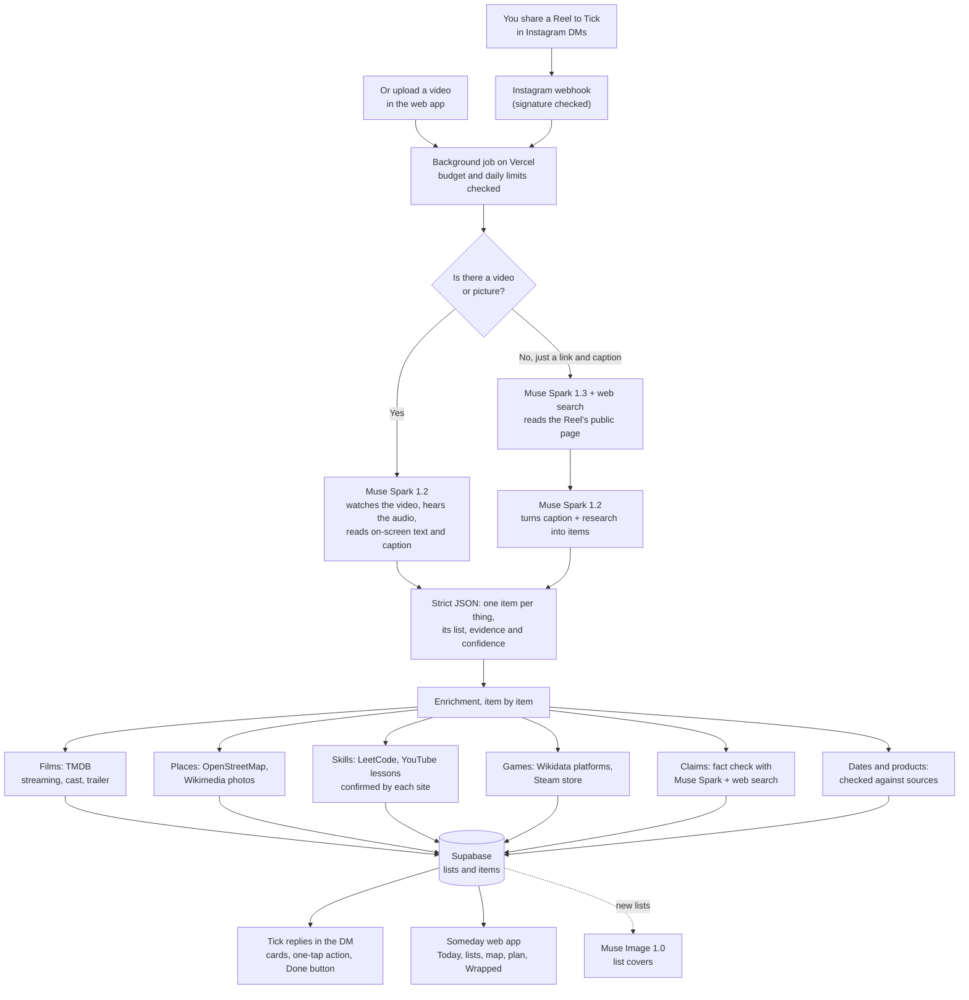

### The rules Tick never breaks

- **Every link is verified.** A link is only shown if a web search actually returned that page, or if the service it points to confirms it exists: LeetCode, YouTube, Steam, TMDB, Wikimedia. Nothing is made up.
- **When it isn't sure, it asks.** Low-confidence items and unverified dates go to *Needs a look* instead of being guessed.
- **Facts come with sources.** A fact check only gives a verdict if it can point to real pages. Otherwise it says *Can't confirm*.
- **Videos are deleted** straight after processing. Someday keeps the notes and the link, never the creator's video.
- **No medical, nutrition, fitness or financial advice.** Those saves are kept as plain notes, and Tick won't fact-check health or money claims.
- **Spending is capped.** There's an overall AI budget, a daily limit per person, and a cap on web searches per Reel.

## Built on Meta

| Meta product | What it does in Someday |
|---|---|
| **Muse Spark 1.2** (`muse-spark-1.2-contributor`) | Watches each video with its audio, reads on-screen text and the caption, and returns every separate thing in the Reel as structured JSON. Also reads photo posts. |
| **Muse Spark 1.3 with web search** (`muse-spark-1.3-contributor`) | Researches shared Reels, pins down the exact film, place or event, checks deadlines, finds lessons, recipes and trailers, fact-checks claims, and powers *Ask Tick* and *Plan with Tick*. |
| **Muse Image 1.0** | Cover art for each list, and clearly labelled illustrations for recipes without a photo. |
| **Files API** | Uploads expire on their own, and Someday deletes each one right after use. |
| **Instagram API with Instagram Login** | Webhooks for shared Reels, notes and button taps. Reply cards with one-tap buttons. ig.me links to connect your account. |

Why Meta's models matter here: Reels are video. The recipe amounts are spoken, the café name is on a sign in the background, and the travel Reel is silent with music on top. Muse Spark understands the whole thing in one request, cheaply enough that Someday can be free.

## Try it

**The easy way:** watch the [demo video](https://www.youtube.com/watch?v=seIgZlR1j8s), then open the [live app](https://someday-lemon.vercel.app), sign in with your email (no password) and **upload a video** from the home page. It goes through exactly the same pipeline as a shared Reel.

**Through Instagram:** the Meta app is still in development mode while it waits for App Review, so only Instagram accounts added as testers can message Tick. If you're a judge and want to try the DM flow, message [@aarbeam_ on X](https://x.com/aarbeam_) and we'll add you.

## Run it yourself

### What you need

- **Node.js 20+**
- **A Supabase project** (the free plan is enough) for sign-in, the database and file storage
- **A Meta Model API key** from [dev.meta.ai](https://dev.meta.ai)
- **A Meta app with the Instagram API**, plus a professional Instagram account to act as the bot. This is only needed for the DM flow. The web app and uploads work without it.
- Optional: a **TMDB API key** for film and TV details

### Steps

```bash
git clone https://github.com/PROSTLE/Someday.git
cd Someday
npm install
cp .env.example .env.local   # then fill it in, see the table below
```

1. **Set up the database.** In the Supabase SQL editor, run the files in [`supabase/migrations`](supabase/migrations) in order (`0001`, `0002`, `0003`). They create the tables, row-level security policies and storage buckets.
2. **Turn on email sign-in** in Supabase, and add your site URL (for example `http://localhost:3000`) to the allowed redirect URLs.
3. **Start the app** with `npm run dev`, then open http://localhost:3000.
4. **Connect Instagram (optional).** Deploy the app somewhere public (Vercel works well), then in your Meta app:
   - set the webhook callback to `https://YOUR-SITE/api/instagram/webhook`, using your `INSTAGRAM_VERIFY_TOKEN`
   - subscribe to the `messages`, `messaging_postbacks` and `messaging_referral` fields
   - subscribe the bot account to your app with `POST /{instagram-account-id}/subscribed_apps`

### Environment variables

Every variable is listed in [`.env.example`](.env.example). **Never commit real values.** `.env.local` is ignored by git.

| Variable | What it's for |
|---|---|
| `NEXT_PUBLIC_SUPABASE_URL`, `NEXT_PUBLIC_SUPABASE_ANON_KEY` | Your Supabase project (safe in the browser) |
| `SUPABASE_SERVICE_ROLE_KEY` | Server-only key for the background pipeline. Keep it secret. |
| `NEXT_PUBLIC_SITE_URL` | The public address of the app, used in DM links |
| `MODEL_API_KEY`, `MODEL_API_BASE` | Meta Model API key, and its base URL `https://api.meta.ai/v1` |
| `MODEL_EXTRACT`, `MODEL_SEARCH`, `MODEL_IMAGE` | `muse-spark-1.2-contributor`, `muse-spark-1.3-contributor` and `muse-image-1.0` |
| `PRICE_*` | Current model prices, used to track spending. Check [Meta's pricing page](https://dev.meta.ai/docs/pricing-rate-limits). |
| `AI_BUDGET_USD`, `MAX_REELS_PER_USER_PER_DAY`, `MAX_ASKS_PER_USER_PER_DAY`, `MAX_SEARCHES_PER_REEL` | Spending and abuse limits |
| `INSTAGRAM_APP_SECRET` | The Meta app secret (App settings → Basic). It signs webhooks. |
| `INSTAGRAM_ACCESS_TOKEN`, `INSTAGRAM_ACCOUNT_ID`, `INSTAGRAM_API_VERSION` | Lets the bot send replies |
| `INSTAGRAM_VERIFY_TOKEN` | Any string you choose. Meta sends it back once to confirm your webhook. |
| `NEXT_PUBLIC_INSTAGRAM_BOT_USERNAME` | The bot's username, without the @ |
| `TMDB_API_KEY`, `TMDB_REGION` | Film details and streaming availability, for a two-letter country such as `IN` |
| `NOMINATIM_URL` | OpenStreetMap geocoding. Follow its [usage policy](https://operations.osmfoundation.org/policies/nominatim/). |
| `SHARE_LINK_SECRET` | Optional. Signs public share links. |

## Project map

```
src/
  app/                    pages (landing, sign-in, connect, the /app web app) and API routes
    api/instagram/webhook   receives DMs, shared Reels and button taps from Instagram
    api/reels/upload        video uploads from the web app
    api/ask, api/plan       Ask Tick and Plan with Tick
  lib/pipeline/           the brain
    process.ts              runs one Reel end to end, then replies in the DM
    extract.ts              Muse Spark reads the Reel and returns items as strict JSON
    research.ts             web research when Instagram only shares a link and caption
    enrich.ts               films (TMDB), places (OpenStreetMap), dates and products
    resources.ts            lessons, photos and recipe kits, each link confirmed
    game.ts                 where to play: Wikidata platforms and the Steam store
    factcheck.ts            claim checks with sources the search really returned
    dm.ts, instagram.ts     reply cards, Done buttons and reminders
  components/             the UI: list views, map, cook mode, Wrapped…
supabase/migrations/      database tables, security policies and storage
```

## Honest limitations

- **Shared Reels arrive without their video.** Instagram's webhook gives a bot only the Reel's public link and caption, and looking up the video needs permissions we don't have. So for shared Reels, Tick researches the public page and the caption. Uploaded videos and photo posts get full video understanding.
- **Instagram Login only works for professional accounts.** Most people have personal accounts, so you connect by sending Tick a one-time code.
- **Instagram only lets a bot reply within 24 hours** of your last message, so reminders arrive with your next share rather than as random pings.
- **Fact checks depend on what the web says today.** The sources can change from one check to the next. Tick links them so you can read them yourself.
- **Console store links open a search** on that store. There's no public API to confirm a console listing, and the app says so.

## Credits

- Film and TV data from [TMDB](https://www.themoviedb.org). *This product uses the TMDB API but is not endorsed or certified by TMDB.* Streaming availability comes from JustWatch, via TMDB.
- Maps and places © [OpenStreetMap](https://www.openstreetmap.org/copyright) contributors. Map tiles by [OpenFreeMap](https://openfreemap.org).
- Photos from [Wikimedia Commons](https://commons.wikimedia.org), credited on each item. Descriptions from Wikipedia.
- Game platforms from [Wikidata](https://www.wikidata.org) (CC0). Store data from Steam.
- Lessons and trailers are YouTube videos, confirmed through YouTube's oEmbed.
- Built with Next.js, Supabase, MapLibre and Vercel.

---

<p align="center">
  Made by <b>Harshit Aryan</b> for the Meta Global AI Developer Hackathon, 2026.<br>
  <i>The world is already on Instagram. Make it work for you.</i>
</p>
